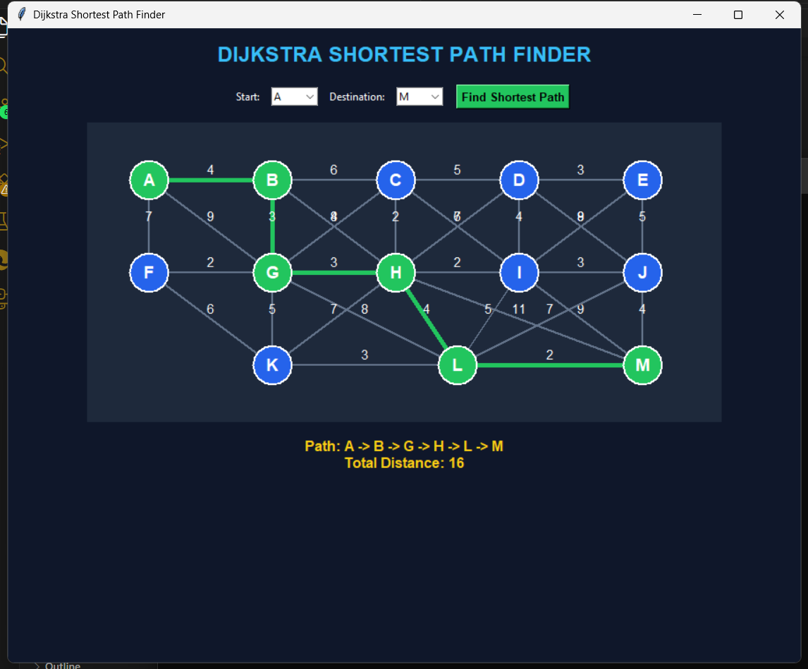

# Dijkstra Shortest Path Finder

Ek chhota desktop application jo Dijkstra's algorithm se do locations ke beech
minimum-distance route find karta hai. Project Python aur Tkinter par bana hai;
example map me 13 locations (A se M) aur unke beech fixed, two-way roads hain.

## GUI



Green nodes aur roads selected shortest route dikhate hain. Road par likha
number us road ki distance hai.

## Features

- Start aur destination ko dropdown menus se select karein.
- Find Shortest Path button se minimum-distance route calculate karein.
- Result me route aur uski total distance dekhein.
- Map par chosen route green me highlight hota hai.
- Start aur destination same hon to distance `0` dikhai jati hai.
- Koi route na ho to app uski jaankari dikhata hai.
- Windows ke liye standalone `.exe` build ki ja sakti hai.

## Algorithm kaise kaam karta hai?

App Dijkstra's algorithm use karta hai. Yeh tab sahi result deta hai jab road
distances non-negative hon; is project ke sabhi distances positive hain.

1. Start location ki distance `0` aur baaki sab locations ki distance infinity
   set hoti hai.
2. Unvisited locations me se ab tak sabse kam distance wali location chuni jati
   hai.
3. Uske har neighbouring location ke liye naya route distance check hota hai.
   Agar naya route chhota ho, to distance aur previous location update hote hain.
4. Destination milne par previous locations ko reverse follow karke final route
   banaya jata hai.

Is implementation me priority queue ke bajay list se minimum-distance location
select hoti hai. Isliye time complexity `O(V^2 + E)` aur space complexity
`O(V + E)` hai, jahan `V` locations aur `E` roads ki tadaad hai.

## Zaroorat

- Python 3
- Tkinter (aam taur par Python ke saath aata hai)

## App chalayein

Project folder me terminal khol kar:

```powershell
py shortest_path_find.py
```

Default example me `A` se `M` ka shortest route `A -> B -> G -> H -> L -> M`
hai aur total distance `16` hai.

## Windows `.exe` banayein

Pehli baar build karne se pehle PyInstaller install karein:

```powershell
py -m pip install -r requirements-build.txt
```

Phir project folder se build script chalayein:

```powershell
.\build_windows.bat
```

Standalone application yahan banegi:

```text
dist\ShortestPathFinder.exe
```

Build ke liye internet sirf PyInstaller install karte waqt chahiye. App chalane
ke liye Python install hona zaroori nahi hai.

## Project files

| File | Kaam |
| --- | --- |
| `shortest_path_find.py` | Tkinter GUI, example map aur Dijkstra implementation |
| `assets/gui-screenshot.png` | Application window ka screenshot |
| `build_windows.bat` | Windows standalone executable build script |
| `requirements-build.txt` | `.exe` build karne ka PyInstaller dependency |
